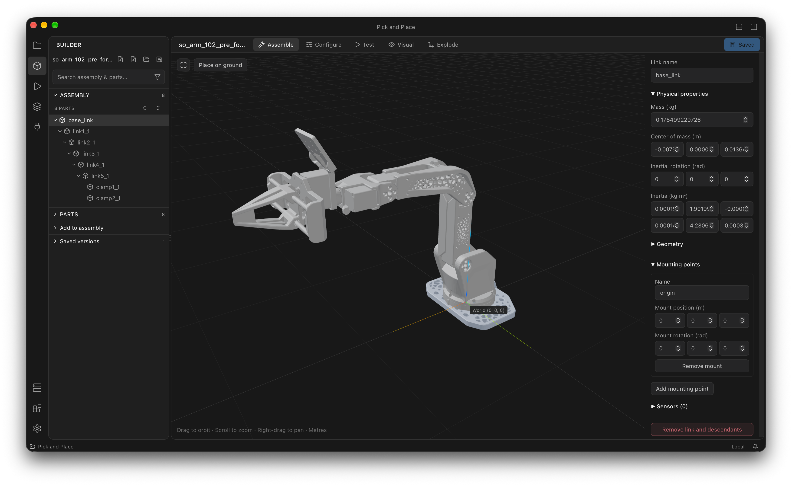

<h1 align="center">Humaan</h1>

  <strong>The learning layer for Physical AI.</strong>

Humaan is building open-source tools to help robots learn from real-world
experience. Build robot projects, inspect and curate recordings, and connect
simulation, training, and evaluation in one workspace.

Our long-term goal is to <strong>make physical intelligence composable</strong> — so
developers can assemble and improve intelligent robot systems from reusable
building blocks.

  <a href="https://humaan.ai">Website</a> ·
  <a href="https://humaan.ai/docs">Documentation</a> ·
  <a href="https://humaan.ai/download">Download</a> ·
  <a href="https://github.com/humaan-ai/humaan/releases">Releases</a> ·
  <a href="#contribute">Contributing</a>

  

## What you can do today

This repository contains two tools for working with robot projects and experiences:

- **Humaan Studio** — a desktop workspace for creating projects, importing
  URDF robots and meshes, running simulations, inspecting recordings, and
  training and evaluating joint-feedback controllers.
- **Humaan CLI** — terminal tools for project identity and recording operations.

Both support local workflows with no cloud account required. Studio's local
simulation and training workflows require an installed MuJoCo runtime.

See the [platform introduction](docs/introduction/index.mdx) for available,
limited, preview, and planned capabilities.

## Why robot experiences?

Robots learn from what they observe, the actions they take, and the outcomes
that follow. Making those experiences easier to inspect and curate is the
starting point for building better learning data.

Our direction is to connect experience, data curation, training, and
evaluation in a continuous learning loop. The current alpha focuses on
local robot projects, recording inspection and curation, simulation, and
limited joint-feedback training and evaluation.

## Get started

- [Download Studio](https://humaan.ai/download) — find available desktop releases.
- [Installation](docs/introduction/installation.mdx) — setup and runtime requirements.
- [First robot experiment](docs/introduction/first-experiment.mdx) — import a robot,
  simulate, train, evaluate, and register a policy.
- [CLI](apps/cli/README.md) — terminal installation and commands.
- [Build Studio from source](apps/desktop/README.md) — development setup and workflows.
- [Project guides](docs/projects/index.mdx) — local project structure and storage.
- [Developer resources](resources/index.mdx) — CLI, API, and integration references.

## Compatibility and limitations

Humaan is in **early alpha**. Interfaces and data formats may change.

- Projects use manifest **version 1**.
- Training currently optimizes a joint-feedback controller for a fixed-base robot.
  It does not train from demonstration datasets or produce image-based policies.
- Registering or assigning a policy does not execute it on hardware. Live Link
  provides read-only telemetry through an external bridge.
- Platform support depends on the release. Check its notes for available installers
  and compatibility limitations.

## Contribute

Help shape Humaan by reporting bugs, sharing robot data workflows, improving
documentation, or contributing code. For development information, start with
the [Studio development guide](apps/desktop/README.md).

- [Report a bug](https://github.com/humaan-ai/humaan/issues/new) — include your
  platform, app version, and steps to reproduce.
- [Request a feature](https://github.com/humaan-ai/humaan/issues/new) — describe
  your robot workflow and the problem you want to solve.
- [Improve the documentation](docs/CONTRIBUTING.mdx) — follow the documentation
  contribution guide.

## License

[Apache-2.0](LICENSE), unless otherwise noted. Third-party dependencies retain
their respective licenses. Trademark rights are subject to the license terms.
