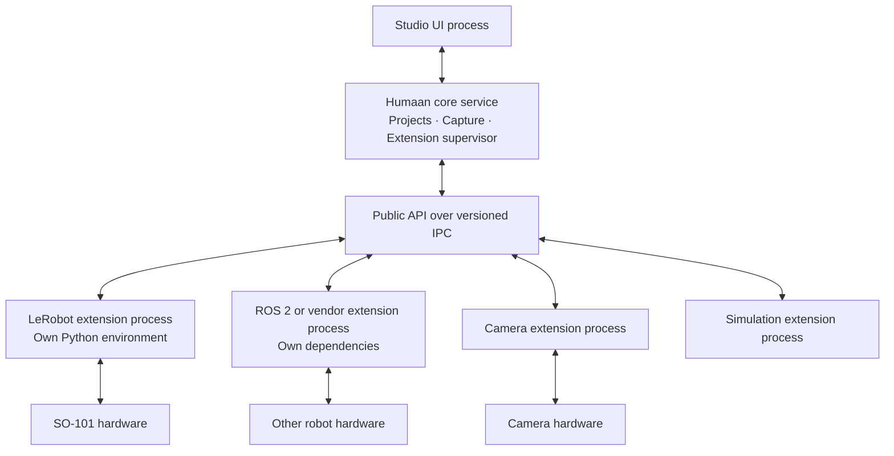
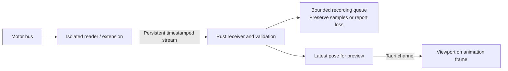

# Proposal: Composable Robotics Through a Stable Core and Extensions

Status: Proposed

Date: 2026-10-21

**Humaan should provide a stable core and a public extension interface. Extensions supply robot drivers, sensors, simulation engines, learning integrations, and specialized tools. Process isolation is a foundational requirement.**

The intended user experience follows the editor-and-extensions model: install Humaan, add the extensions needed for a project, and continue using that project as Humaan evolves. LeRobot becomes a dependency of an optional extension.

VS Code provides useful precedents: a dedicated extension host, declared application compatibility, and a distinction between stable and experimental APIs. Humaan should adopt these architectural principles with additional contracts for physical devices and recorded evidence. [Extension host](https://code.visualstudio.com/api/advanced-topics/extension-host), [extension compatibility](https://code.visualstudio.com/api/working-with-extensions/publishing-extension#visual-studio-code-compatibility), [proposed APIs](https://code.visualstudio.com/api/advanced-topics/using-proposed-api)

Separating core and extension code enables independent development. Backward compatibility also requires stable message semantics, version negotiation, data readers, and release tests. Process isolation provides a separate guarantee: failures in an extension can be contained and recovered.

This document proposes that architecture. The extension system and compatibility guarantees described below are not yet implemented.

**Current foundation**

The [SO-101 reader](apps/desktop/tools/so101_telemetry.py) already runs outside Studio, imports LeRobot, and reads measured motor positions. The [telemetry bridge](apps/desktop/tools/telemetry_bridge.py) exposes generic named positions, which Studio maps into a saved robot model.

This is a useful initial process boundary. It still needs a managed lifecycle, a versioned protocol, dependency packaging, and structured diagnostics. Setup currently requires terminal commands and manual mapping. Live Link supports observation and recording; physical execution remains future work.

**Core and extension responsibilities**

| Area | Stable core owns | Extensions provide |
| --- | --- | --- |
| Workspace | Project identity, versioned robot models, storage contracts, migrations | Namespaced configuration and provider-specific metadata |
| Studio | Navigation, viewport, shared connection and recording UI | Declarative commands, settings, device descriptions, and contributed views through public APIs |
| Extension management | Compatibility checks, installation records, process supervision, activation, logs | Manifest, executable entry point, supported platforms, packaged dependencies |
| Device integration | Common capability descriptions, connection state, binding validation | Discovery, hardware communication, calibration routines, device-specific conversions |
| Capture and learning | Timestamped recording, provenance, review, learning-set contracts | Sensor streams, dataset import/export, trainers, policy runtimes, evaluators |
| Execution | Explicit activation, command ownership, validation, fault reporting | Supported command modes and integration with the robot's controller and stop behavior |

First-party extensions should use the same public interface available to external authors. Extensions must communicate through that interface rather than importing internal Rust structures, Svelte stores, or manipulating Studio's DOM.

Existing integrations can move behind this boundary incrementally. Core remains responsible for reading saved canonical data even when the extension that produced it is absent.

**Process isolation**

Each activated extension should run in a supervised process, with its own runtime and dependency environment. For example, the LeRobot extension can use a pinned Python environment while a vendor extension runs a native executable.

The core service runs independently of viewport rendering. Begin with local extension processes; a future remote host must define authentication, clocks, and disconnect behavior before supporting network deployment.

The supervisor should:

- Start extensions when their capabilities are needed and negotiate compatibility before connecting devices.
- Track process liveness separately from measurement freshness. An alive process can still be serving stale data.
- Apply request deadlines, validate message sizes and values, and bound queues so an overloaded extension cannot accumulate unlimited data in core.
- Surface crashes, timeouts, and dependency failures with extension-specific logs while keeping the workspace and unrelated extensions usable.
- Offer controlled restart and reconnection. Restarting a process must not automatically resume physical motion.
- Enforce exclusive device ownership among managed extensions and report conflicts with other programs using a device.

**Process isolation, dependency isolation, API compatibility, and security isolation are distinct.** Separate processes isolate address spaces and many crashes; separate environments isolate dependency versions. Versioned contracts preserve compatibility. Filesystem, network, and device restrictions require enforceable operating-system controls. A subprocess alone is not a sandbox, and resource limits need their own implementation.

Physical behavior also needs an independent failure response. A driver crash can leave a motor controller executing its last command. Before supporting motion, validate watchdogs and stop behavior in the robot controller or another component that survives the extension failure. The correct response depends on the robot; removing torque is not universally safe.

**Public contracts and backward compatibility**

The stable boundary should use serialized messages so extensions can be written in Python, Rust, or other languages without sharing a compiler or in-process binary interface with Humaan.

Start with a documented local IPC protocol for lifecycle requests, capability discovery, configuration, observations, and diagnostics. Include request IDs, structured errors, sequence numbers, source timestamps, clock identity, and stream identity. High-volume image streams can use a separately negotiated data transport while preserving the same metadata contract.

Version these concerns independently:

| Versioned item | Compatibility rule |
| --- | --- |
| Humaan application | Declare the public API and protocol versions each release supports |
| Extension package | Declare required API versions, capabilities, platform/runtime requirements, and any application constraints |
| Public API and wire protocol | Preserve existing meanings within a stable major version; negotiate optional additions |
| Project and recording formats | Keep readers for supported older formats and explicit migrations for incompatible changes |
| Extension configuration | Namespace and version configuration; let the owning extension validate migrations |
| Device binding and calibration | Preserve units, reference frames, conversion semantics, hardware identity, and calibration provenance |

An extension manifest should identify its publisher and package, version, entry point, dependency environment, activation conditions, contributed capabilities, and compatibility requirements. SDKs should wrap the public protocol; they must not make internal core structures part of the extension contract.

The proposed compatibility policy is:

1. **Stable APIs preserve behavior.** Adding an optional field or capability must leave old behavior intact when it is absent. Units, coordinate frames, default values, error meanings, and command semantics are part of the contract.
2. **Both sides negotiate support.** Older extensions continue using their supported API on newer core releases that retain it. Extensions requiring newer capabilities are rejected before activation on older cores, with an actionable explanation.
3. **Breaking changes get a new contract.** Introduce a new major API or message version and retain a compatibility implementation for the published support window. Document deprecation and end-of-support dates before retirement.
4. **Experimental APIs stay explicit.** Use a separate opt-in channel for unstable capabilities. Stabilize contracts after validating them with more than one integration.
5. **Installation is reproducible.** Record extension versions, package fingerprints, resolved dependency versions, and configuration schema versions with project setup and recording provenance. Preserve a known working version and support rollback when the stored configuration remains compatible.
6. **Upgrades respect active devices.** Stage extension updates while a device is in use; activate them after disconnect. Never change driver dependencies or calibration semantics during a recording or motion session.

Backward compatibility is a published, tested support policy. It cannot promise that every extension will run forever across unsupported operating systems, unavailable vendor libraries, or changed firmware.

**Preserving existing projects and recordings**

Introduce the extension system alongside the current workflow:

- Provide a bundled compatibility provider for the existing localhost telemetry bridge.
- Keep readers for existing robot profiles and sessions, including their current shapes without explicit schema versions. Recognize and validate those legacy shapes before migration.
- Preserve existing mappings and calibration values exactly. Changing a gripper's percentage, motor-angle, or jaw-opening interpretation requires an explicit new binding.
- Make migrations explicit and recoverable. Keep originals, and avoid rewriting saved files merely because a user opens a project.
- Keep robot snapshots and canonical recorded measurements usable for replay when an extension is missing or disabled. Preserve unknown extension configuration without executing it or silently deleting it.
- Store new provenance in declared artifacts or an explicitly versioned format. The current [recording manifest v1](specs/recording-format/README.md) rejects unknown fields, so extension metadata must respect that contract.

Application rollback and data rollback are different operations. A newer data format may require migration to a copy or export into an older supported format before an older application can read it.

**Composing robots and behaviors**

| Contract | What it describes | Example |
| --- | --- | --- |
| Robot definition | Geometry, joints, physical properties, attachment points | An arm with a mounted gripper |
| Hardware capabilities | Available measurements, commands, units, limits, and connection requirements | Joint positions, gripper opening, camera images |
| Behavior requirements | Inputs and capabilities a task or policy needs | A grasp behavior requiring a camera and controllable gripper |

An imported URDF supplies the model. A hardware extension binds that model to a device. A behavior declares the capabilities it requires. This supports an arm, gripper, and camera from different providers while keeping a shared workflow in Studio.

LeRobot can remain one integration provider, alongside ROS 2 and vendor SDKs. Their existing interfaces inform the adapters inside Humaan extensions. [LeRobot hardware integration](https://huggingface.co/docs/lerobot/main/en/integrate_hardware), [ros2_control architecture](https://control.ros.org/rolling/doc/getting_started/getting_started.html)

Supporting multiple robots and transferring intelligence between robots remain separate milestones. A policy requires compatible observation meanings, action semantics, timing, and physical capabilities. Reuse across different bodies may require retargeting, different controllers, additional training, and evaluation.

**Requirements from the SO-101 demo**

Calibration needs a clear owner and history. The hardware extension should handle encoder calibration and device-specific conversions. A versioned binding then aligns those measurements with the Builder model. Studio should display units, direction, zero alignment, and the active calibration.

Recording must run independently of rendering. Currently, the bridge retains the latest sample and Studio records samples it receives while polling. The core capture service should record source-timestamped samples continuously, report gaps and achieved rates, and let the viewport consume updates separately. Source and receipt timestamps must remain distinguishable. Preview frames may be skipped; recording loss must be reported.

Connection health needs actionable diagnostics. "Extension exited," "serial device disappeared," "calibration mismatch," and "no fresh measurements" should be separate states with a clear recovery action.

**Reducing telemetry latency while keeping process isolation**

Replace repeated snapshot requests with a persistent subscription. The extension remains a separate process and publishes each new measurement as soon as it is available.

The current code shows these timing constraints:

| Current behavior | Consequence |
| --- | --- |
| The SO-101 reader defaults to 20 Hz | A target interval of 50 ms between reads, subject to actual motor-bus read duration |
| Studio polls every 100 ms | Up to approximately one polling interval of additional scheduling delay under normal conditions; busy requests or UI stalls can extend it |
| Each `deployment_sample` call opens a TCP connection and reads one packet | Repeated connection, worker, and IPC overhead |
| The bridge stores only the latest packet | Intermediate measurements can disappear before Studio polls |
| Recording appends samples in the UI | Capture timing depends on frontend scheduling |

These are code-derived constraints, not a measured end-to-end latency breakdown. The reader already uses `flush=True`, so enabling unbuffered output alone does not address the polling delay.

The proposed data path is:

Implementation decisions:

1. **Keep one connection open.** Add an explicitly selected streaming endpoint alongside the existing snapshot endpoint. A Rust background receiver continuously reads framed messages. For supervised local extensions, pipes can carry the same protocol directly. Keep transport details behind the public contract.
2. **Publish new samples immediately.** Use a persistent reader/writer rather than a timer that repeatedly requests the latest value. Keep JSON initially for the small joint-position payloads and measure serialization cost before changing encoding. If using TCP, enable `TCP_NODELAY` on the sender to avoid Nagle buffering of small writes; this does not guarantee a particular latency. [Rust socket option documentation](https://doc.rust-lang.org/std/net/struct.TcpStream.html#method.set_nodelay)
3. **Stream preview updates through a Tauri channel.** Use one subscription and explicit cancellation on disconnect, profile change, or window teardown. Tauri documents channels as its streaming mechanism. [Tauri channels](https://v2.tauri.app/develop/calling-rust/#channels)
4. **Bound preview delivery before it enters the frontend queue.** Keep the latest pose in Rust and use acknowledgement or demand from the UI to limit outstanding preview messages. Replace an unsent preview with a fresher one. Apply it on the next animation frame without replaying a backlog of old live poses. This preview policy must not discard recording samples.
5. **Capture independently in the backend.** Preserve every received measurement and its source timestamp through a bounded recording queue. Detect missing sequence numbers and queue overflow. Mark the session incomplete or stop capture with a clear error when capacity is exceeded; never silently present a partial stream as complete.
6. **Measure before raising the hardware rate.** Preserve the initial 20 Hz target, measure motor-bus read duration and achieved rate, and then evaluate higher rates within the device's supported limits. Increasing reader FPS alone cannot fix the current UI polling bottleneck.

Streaming messages should carry a protocol version, stream-instance ID, sequence, source timestamp and clock identity, and positions with declared units. Restarting a reader creates a new stream instance, so a reset sequence cannot be confused with old data. Distinguish heartbeat, sample, error, and end-of-stream messages; a heartbeat must never make an old measurement appear fresh. When the device supplies no acquisition timestamp, label the reader's read-completion timestamp as an approximation.

Measure motor read duration, extension-to-core delivery, core-to-viewport update delay, sample rate, gaps, and queue depth. Report median and p95 delays under idle and busy UI conditions. Cross-process timing needs a documented shared clock or clock-offset estimation with uncertainty; Python, Rust, and browser timestamps cannot simply be subtracted without establishing their relationship.

The first expected improvement is removal of the fixed 100 ms polling wait. The physical sampling interval, bus read time, operating-system scheduling, and display refresh remain. Set an end-to-end latency target after collecting the baseline.

Backward compatibility requires both modes during migration: old clients keep receiving one snapshot per connection, and new clients explicitly select the versioned stream. Preserve existing port settings and saved profiles. Expose when the legacy mode is active, since it cannot recover samples already overwritten in the old bridge.

Validation should compare the existing path and the streaming path with the same timestamped synthetic producer, then repeat with the SO-101. Cover a stalled viewport, slow recorder, reader exit, restarted sequence, malformed messages, and disconnect cleanup. The synthetic run isolates application overhead; the physical run measures the hardware contribution.

**Implementation milestones**

| Stage | What we build | Evidence that it works |
| --- | --- | --- |
| **1. Preserve the baseline** | Legacy bridge provider, profile/session fixtures, documented current semantics | Existing saved sessions and mappings still load and replay |
| **2. Introduce isolated extensions** | Supervisor, proposed IPC contract, packaged SO-101 extension, simulated extension, independent capture | Users connect and record through Studio; crashing or hanging an extension leaves core usable and records a stream interruption |
| **3. Validate and stabilize API v1** | A second physical robot integration using ROS 2 or a vendor SDK; compatibility negotiation and release tests | Both robots use the same UI; an unchanged older extension package works against a newer core in the supported matrix |
| **4. Connect capture to learning** | Sensor streams, clock alignment, provenance, recording conversion | A physical session can be reviewed and selected for a learning set with original measurements preserved |
| **5. Add physical execution** | Explicit activation, command ownership, limits, watchdogs, validated fault responses | Driver crash, UI exit, stale commands, and disconnect tests produce the intended hardware response |
| **6. Compose reusable behaviors** | Task and policy extension contracts, compatibility checks, evaluation evidence | A task workflow runs on two supported robot configurations using the appropriate controller for each |

Release checks should exercise frozen older extension packages, saved project fixtures, protocol negotiation failures, missing extensions, crashes, hangs, and rollback. Test the oldest supported core for each declared extension range as well as the newest. A current SDK compiling successfully is insufficient evidence of backward compatibility.

The next implementation milestone is **a supervised SO-101 extension with a versioned process boundary and preserved legacy data**. Start with local installation and a simulated extension for failure testing. Use a second physical robot to validate the abstraction before declaring API v1 stable.
